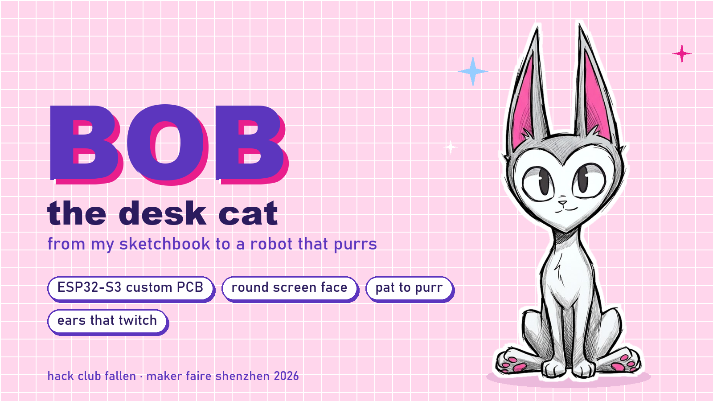
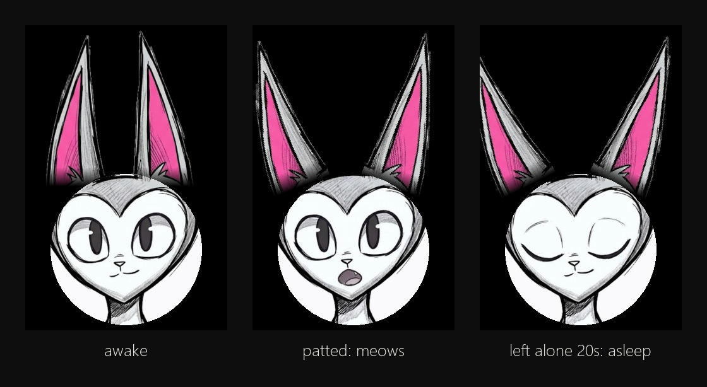

# Bob, the desk cat

Bob started as a cat in my sketchbook. Now he's becoming a palm-sized robot on my own ESP32-S3 board:
a round screen is his face, two servo ears and a servo tail move for real, a touch pad lets you pat him,
a mic hears you and a speaker lets him meow. Everything runs offline.

Built for Hack Club Fallen (Maker Faire Shenzhen, Dec 2026).



## Status
- [x] Parts list: [bom.csv](bom.csv), costs in [REPORT.md](REPORT.md)
- [x] Schematic (KiCad): [hardware/](hardware/)
- [ ] PCB layout: parts placed, routing the last few wires, then DRC and order
- [x] Face simulator: [face/face.py](face/face.py) (blinks, breathes, ears twitch, meows when patted, sleeps when ignored)
- [ ] Port the face to the ESP32 + GC9A01
- [ ] Body: plan in [BODY.md](BODY.md)

## Hardware
- ESP32-S3-WROOM-1 (N8R8) module on a custom 2-layer board, about 73 x 63 mm
- GC9A01 1.28" round 240x240 screen (the face)
- 3 x SG90 servos: left ear, right ear, tail
- Capacitive touch pad, electret mic + MCP6001 preamp
- PAM8302 class-D amp + 30 mm speaker
- USB-C power and programming, AP2114H 3.3 V regulator

## Face simulator
```
py -3 -m pip install pygame-ce
py -3 face/make_meow.py      # builds meow1-3.wav from sine waves, no recording
py -3 face/face.py           # click = pat
```
The ears turn around their base like servo horns and ease into place, so the same angles can drive the real servos later.
