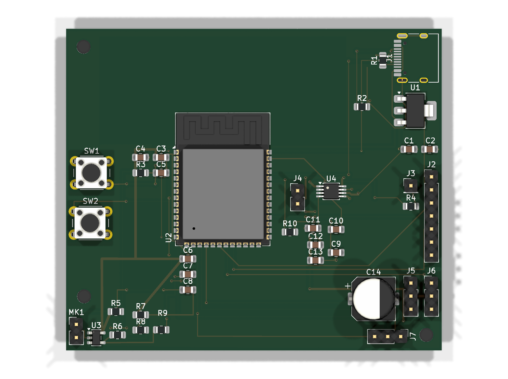
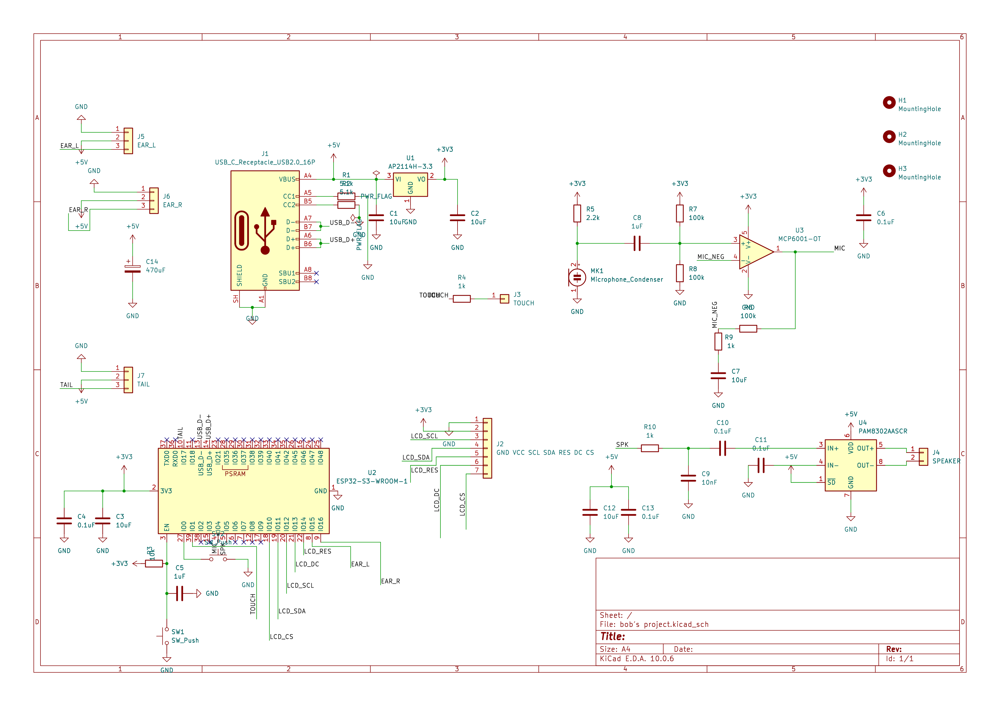

# Bob, the desk cat

## The story

Bob is a cat that I drew in my sketchbook. Further up he went into the Wispr Flow hiring challenge as the main character that introduces my portfolio for that challenge.

After the completion of the challenge I moved on to Hack Club's Fallen, which is like a hard hackathon lasting 2 months. You build the project by hand: no AI, no bot can help you. You record your time, you get your XP, and stuff like that.

## Why I'm building him

Bob, the bot named Bob, is my cat, my sketchbook inspiration. Why am I building him? The reason that I'm building Bob is that I could feel less lonely while coding and while doing things.

## What Bob can do

What Bob can do is this: he has a screen, a mic, a speaker, and 3 servos. When we touch Bob he acts like an ordinary cat. He yawns, sleeps, and wakes up. His mic, speaker, and servos are all connected.

## The board

The board that I'm using is the ESP32-S3, 73 mm x 62.5 mm, 38 parts, and USB-C. These are the parts that are going to be on the board. As for the checks there are 0 ERC errors, 0 DRC errors, and 0 unconnected things.

## The hardest part

The next little bit of a bad story is that the USB D+ wire was a really tough one. That was the only single wire that I needed to connect in the entire schematic so that I could submit. As it was the last one, when I was going to connect it, there was no way. I had to reconnect so many wires, some of which I had to, and change the schematic design, replace parts, and stuff like that. It's been a really tough one until now.

## Cost and what's next

The cost of all the parts is ₹1,600 as I'm from India. What's next is that I'm going to be submitting the online version of Bob for now: the schematic, the PCB design, the doc, and the readme. Then I have to order all the hardware parts that I need to build him so that we can move on more quickly and probably go design.

## Files

- `hardware/` KiCad schematic and PCB
- `hardware/fab/` Gerbers for JLCPCB, BOM, parts positions, schematic PDF, board renders
- `bom.csv` shopping list
